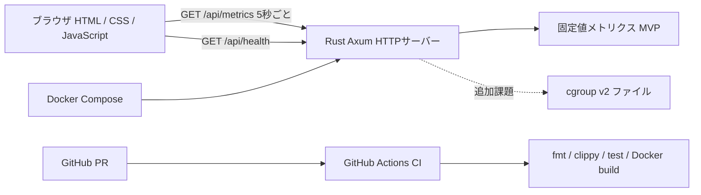

# 01. 企画・全体設計

## 1. 背景と目的

Rustを初めて扱う開発担当者と、レビュー・進行管理を担当するメンバーの2名で、小規模な**サーバー監視ダッシュボード**を作成する。完成品の高度さよりも、以下の開発プロセスを体験することを優先する。

- GitHub Issuesによるタスク管理
- featureブランチ、Pull Request、レビュー、マージというGitHub Flow
- GitHub ActionsによるCI（フォーマット・静的解析・テスト・Dockerビルド）
- Codex CLI等によるAI支援コーディングとAIレビュー
- Rust/Axum、Docker Compose、最小限のHTML/CSS/JavaScript

## 2. 人員と時間

- 開発担当: **10人時**（Rust未経験）
- 管理・レビュー担当: **5人時**
- **合計15人時**。15時間×2名ではない。

## 3. MVPと追加課題

### 必須MVP

- `GET /api/health`が稼働状況をJSONで返す。
- `GET /api/metrics`がCPU・メモリ使用率の**固定値**をJSONで返す。
- ブラウザ画面にCPU・メモリ使用率が表示され、約5秒ごとに再取得する。
- Docker Composeでローカル起動できる。
- PRでCIが実行される。
- READMEとIssue/PRの記録が残る。

### 追加課題（時間が余れば）

- cgroup v2から**コンテナ自身**の実測値を取得する。
- 直近の測定値をブラウザ内でグラフ化する。
- GHCR（GitHub Container Registry）へのDockerイメージ公開。

## 4. 構成図

## 5. 採用技術

| 領域 | 採用 | 理由 |
|---|---|---|
| Web API | Rust + Axum + Tokio + Serde | Rustと非同期HTTP/JSONの基礎を学ぶ |
| フロントエンド | 素のHTML/CSS/JavaScript | 学習対象を増やしすぎない |
| コンテナ | Docker / Docker Compose | 実行環境を共有しやすい |
| ソース管理 | GitHub Issues / PR | レビューと作業履歴を残す |
| CI | GitHub Actions | PRごとの自動検証を体験する |
| AI | Codex CLIなど（開発時のみ） | コード生成・説明・レビューの補助 |

## 6. 今回やらないこと

データベース、ユーザー認証、React、Kubernetes、クラウド本番公開、ホスト全体の厳密な監視、アラート通知、LLMをアプリに組み込む機能。

## 7. 費用に関する整理

**完成した監視ダッシュボードの実行にAI APIトークン費用は発生しない**（アプリにLLMを組み込まないため）。ただし開発時のCodex等の利用料金、GitHubやホスティングの利用条件、Dockerを動かす計算資源の費用は別途確認する。

## 8. 完了の判断

MVPが動作し、CI成功・PRレビュー・README・デモが揃えば完了。cgroup v2実測やGHCR公開は未完了でもよい。
