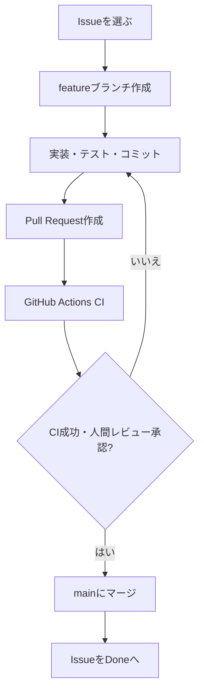

# 04. GitHub Flow・CI/CD・Projects・Codex CLI

## 1. GitHub Flow



例:

```bash
git switch main
git pull --ff-only
git switch -c feature/metrics-api
# 実装する
cargo fmt
cargo test
git add .
git commit -m "feat: add mock metrics API"
git push -u origin feature/metrics-api
gh pr create --repo rjc-4g/202610-team-b --title "feat: add mock metrics API" --body "Closes #<実際のIssue番号>"
```

PRには概要、確認方法、関連Issue（`Closes #番号`）を記載する。管理担当がレビューし、CI成功後にマージする。可能であればmainのブランチ保護またはrulesetでレビュー・CIを要求する。

CI導入前のSetup/API等のPRでは、手元で実行した確認結果を記載してレビューする。CI Issueの完了後は自動検証の成功を確認する。Issueの完了条件をすべて満たすPRだけに`Closes`を付け、部分的な作業では`Refs #番号`とする。

## 2. GitHub Actions CI例

`.github/workflows/ci.yml`:

```yaml
name: Rust CI
on:
  pull_request:
  push:
    branches: [main]
permissions:
  contents: read
jobs:
  test:
    runs-on: ubuntu-latest
    steps:
      - uses: actions/checkout@v4
      - uses: dtolnay/rust-toolchain@stable
        with:
          components: rustfmt, clippy
      - name: Format
        run: cargo fmt --all -- --check
      - name: Clippy
        run: cargo clippy --all-targets -- -D warnings
      - name: Test
        run: cargo test --locked
      - name: Docker build
        run: docker build -t rust-monitor:ci .
```

> 実行環境とアクションのバージョンは導入時点で確認する。CD（GHCR公開）は追加課題。公開には適切な`packages: write`権限が必要。

## 3. GitHub Projectsのカンバン

登録済みProject: **[202610-team-b（#7）](https://github.com/orgs/rjc-4g/projects/7)**。作成時の名前は「Rustサーバー監視ダッシュボード開発」で、2026-10-21の確認時点では現在名に変更されている。[Boardビュー](https://github.com/orgs/rjc-4g/projects/7/views/2)を利用する。

| Status | 意味 |
|---|---|
| Todo | 未着手 |
| In Progress | 開発中 |
| In Review | PRレビュー中 |
| Done | 完了 |

ProjectはリポジトリのIssueと別の管理オブジェクトで、作成後にIssueを追加する。本Projectはリポジトリとの紐づけ、開発Issue 7件の追加、上記4つのStatus、Boardビューを設定済み。テスト用Issueは対象外とする。

```bash
gh auth status
gh project list --owner rjc-4g
# 上の一覧で確認した既存Projectを使う（本プロジェクトは7）
PROJECT_NUMBER=7
gh project item-list "$PROJECT_NUMBER" --owner rjc-4g
gh project field-list "$PROJECT_NUMBER" --owner rjc-4g
```

権限が不足する場合のみ`gh auth refresh -s project`で認証する。新しいIssueを追加する際は、Issue一覧で確認したURLを`gh project item-add`に渡す。既存Projectを重複作成しない。今回のStatus選択肢とBoardビューは`gh api graphql`で設定した。変更にはGitHub Web UIも利用できる。

作業開始時にIn Progress、PR作成時にIn Review、マージして完了条件を満たしたらDoneへ手動で移動する。PR作成・マージに連動したStatusの自動更新は設定・検証していない。

## 4. Issueをghで作る

本計画の7件は登録済み。以下は新規登録が必要な場合の手順例であり、既存のSetup Issueを再作成しない。

```bash
gh auth status
gh issue list --repo rjc-4g/202610-team-b --state all

gh issue create \
  --repo rjc-4g/202610-team-b \
  --title "[Setup] Rust開発環境とGitリポジトリの構築" \
  --body-file issue-body.md
```

Issue本文には「目的」「見積工数」「作業内容」「完了条件」「担当役割」を入れ、完了条件はチェックボックスにする。7件の内容は[03-issues-plan.md](03-issues-plan.md)を参照する。Issue番号を決め打ちせず、既存Issueを消さない。

## 5. Codex CLIへの依頼例

```text
GitHub CLI（gh）を使って、rjc-4g/202610-team-b に
docs/project-inception/03-issues-plan.md の7件の開発Issueを確認し、
未登録分だけを登録してください。登録済みのIssueは再利用してください。
実行前に gh auth status と gh issue list で権限と重複を確認してください。
各Issueに目的、見積、担当、作業、完了条件のチェックリストを記載してください。
既存Issueは変更・削除しないでください。
作成後はIssue番号・タイトル・URLを一覧で報告してください。
```

Projects用:

```text
GitHub CLIでrjc-4g組織の既存Project #7「202610-team-b」を確認し、
リポジトリにリンクされていることを確認してください。
開発用Issueを追加し、StatusをTodo / In Progress / In Review / Doneで
管理できるようにしてください。既存ProjectやIssueは消さず、
対応できない操作は実施済みと報告しないでください。
```

## 6. GitHub連携で遭遇した権限エラー

ChatGPTのGitHub連携でIssueの読み取りは成功したが、新規作成時に`403 Resource not accessible by integration`が発生した。個人アカウントのGitHub App設定では組織`rjc-4g`のリポジトリを選択できなかった。

- 個人用のAppインストール設定と組織用設定は別。
- 組織Ownerの承認や組織へのインストールが必要な場合がある。
- **リポジトリ閲覧権限とIssues書き込み権限は別。** App自体が書き込みをサポートしない場合はOwnerでも追加できない。
- 回避策として、適切なGitHub権限を持つユーザーがローカルの`gh`で作成する方針を検討した。
- `gh auth`とChatGPTコネクタの認証は別。

その後、このリポジトリでは`gh`によるIssue作成が成功した。Projects操作時にはトークンに`read:project`がないエラーが発生したが、`gh auth refresh -s project`で作成・編集用の権限を追加した後、Project作成と設定に成功した。

関連するGitHub Appの設定画面やGitHub Projectsの操作は、GitHub公式画面で確認する。操作時のスクリーンショットはこの資料には同梱しない。
